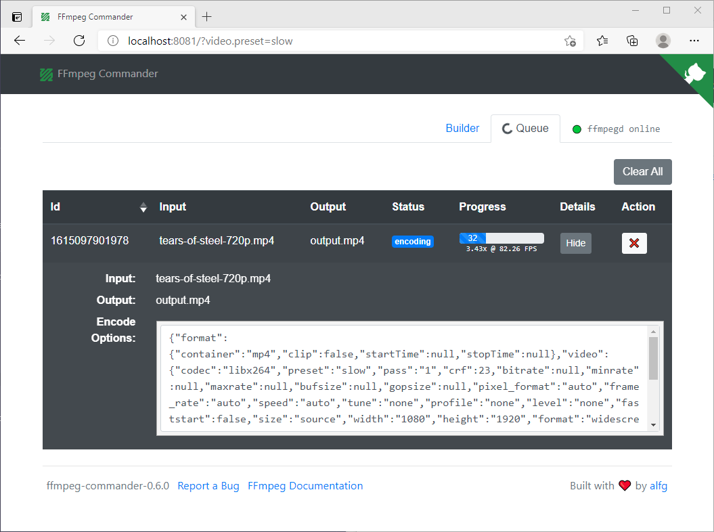

# `ffmpegd`
[FFmpeg](https://www.ffmpeg.org/) websocket server and API for [FFmpeg Commander](https://ffmpeg-commander.com).

[](https://pkg.go.dev/github.com/alfg/ffmpegd)
[](https://goreportcard.com/report/github.com/alfg/ffmpegd)

[](https://github.com/alfg/ffmpegd/actions/workflows/go.yml)
[](https://github.com/alfg/ffmpegd/actions/workflows/docker.yml)
[](https://github.com/alfg/ffmpegd/actions/workflows/release.yml)

## How It Works
`ffmpegd` connects [FFmpeg Commander](https://ffmpeg-commander.com) to [ffmpeg](https://www.ffmpeg.org/) by providing a websocket server to send encode tasks and receive realtime progress updates back to the browser. This allows using `ffmpeg-commander` as a GUI for `ffmpeg`.

The goal is to provide a simple interface for sending FFmpeg tasks from the browser (and other supported clients in the future) to your local machine.

See [Usage](#Usage) for more details.

### Versions
`ffmpegd` and `ffmpeg-commander` share version numbers: releases with the same major.minor version (2.1.x with 2.1.x) speak the same payload format. Update `ffmpegd` when ffmpeg-commander moves to a new minor version.

```
          process              websocket
[ffmpeg] <-------> [ffmpegd] <-----------> [ffmpeg-commander]
```

## Install
### Homebrew
Installs `ffmpegd` along with `ffmpeg`:
```
$ brew install alfg/tap/ffmpegd
```

### Go
Requires Go 1.26 or newer:
```
$ go install github.com/alfg/ffmpegd@latest
```

### Download
Release binaries for your platform at:
https://github.com/alfg/ffmpegd/releases

### Docker
A Docker image with an [alfg/ffmpeg](https://github.com/alfg/docker-ffmpeg) build installed is available on the GitHub Container Registry:
```
$ docker run -it -p 127.0.0.1:8080:8080 -v /tmp/:/home ghcr.io/alfg/ffmpegd
```

Or using the Docker Compose example:
```
$ docker compose up ffmpegd
```

## Usage
* [ffmpeg](https://www.ffmpeg.org/download.html) must be installed and available on your `$PATH`.
* Run `ffmpegd`:
```
$ ffmpegd
```

This will start the websocket server in your current working directory and wait for a connection. Input and output paths are relative to this directory.

* Go to https://ffmpeg-commander.com/ in the browser
* Enable `ffmpegd` in Options.
* Once connected, you can start sending encode jobs to ffmpegd!

### Options
```
$ ffmpegd help

Usage:
  ffmpegd [--host address] [port]   Run server on localhost:8080 by default.
  ffmpegd version                   Print version.
  ffmpegd help                      This help text.

Options:
  --host address   Address to listen on. Use 0.0.0.0 to let other machines on
                   your network connect. Can also be set with $FFMPEGD_HOST.
```

By default `ffmpegd` only accepts connections from your own machine. Only listen on other addresses on a network you trust: anyone who can reach `ffmpegd` can run encodes and list files in its directory.

## Example
### `ffmpegd` with a job in progress from `ffmpeg-commander`
```
$ ffmpegd

███████╗███████╗███╗   ███╗██████╗ ███████╗ ██████╗ ██████╗
██╔════╝██╔════╝████╗ ████║██╔══██╗██╔════╝██╔════╝ ██╔══██╗
█████╗  █████╗  ██╔████╔██║██████╔╝█████╗  ██║  ███╗██║  ██║
██╔══╝  ██╔══╝  ██║╚██╔╝██║██╔═══╝ ██╔══╝  ██║   ██║██║  ██║
██║     ██║     ██║ ╚═╝ ██║██║     ███████╗╚██████╔╝██████╔╝
╚═╝     ╚═╝     ╚═╝     ╚═╝╚═╝     ╚══════╝ ╚═════╝ ╚═════╝
                                                      v2.1.0

[ffmpegd] - websocket server for ffmpeg-commander.

  Checking FFmpeg version....9.0.1
  Checking FFprobe version...9.0.1

  Server started on http://localhost:8080.
  - Go to https://ffmpeg-commander.com to connect!
  - ffmpegd must be enabled in ffmpeg-commander options.

Encoding tears-of-steel.mp4 -> tears-of-steel-720p.mp4
Encoding... 34.68% 3.37x @ 80.77 fps
```


## WebSocket Demo
See [demo](demo/) for a websocket client example.

## Task tracking
Each encode can carry a stable `id` chosen by the client, and each connection
can present a stable `client_id`. The server tracks every task through a fixed
lifecycle and echoes the same `id` on all of its events, so multiple browsers
can share the server without their jobs becoming confused.

### Lifecycle
```
queued ──► running ──► complete
                 ├──► failed
                 └──► cancelled   (a queued task can also be cancelled before it runs)
```

A task reaches exactly one terminal state — `complete`, `failed` or
`cancelled`. It is never executed twice, and it can never report both
completion and cancellation.

### Messages
Connect with an identity, optionally in the URL: `ws://host/ws?client_id=<id>`,
or send `{"type":"hello","client_id":"<id>"}` after connecting. The server
replies with a `welcome` event and a `tasks` snapshot of that client's jobs.

| Client message | Purpose |
|----------------|---------|
| `encode` (`id` optional) | Queue an encode; with an `id`, events use the typed protocol. |
| `cancel` (`id` optional) | Cancel a specific owned task, or the caller's running encode when no `id`. |
| `status` (`id`) | Query the latest state of one owned task. |
| `tasks` | List all tasks owned by this client, including terminal results. |
| `hello` (`client_id`) | Claim a stable identity on an anonymous connection. |

Server events (`queued`, `started`, `progress`, `complete`, `error`,
`cancelled`, `status`, `tasks`, `welcome`) are JSON objects with a `type` and,
for task events, the matching `id` and a `state`. For example:

```json
{"type":"progress","id":"task-1","state":"running","percent":42.5,"speed":"3.1x","fps":80.2}
{"type":"complete","id":"task-1","state":"complete","percent":100}
```

### Cancellation and disconnect rules
* A client can only cancel tasks it owns; cancelling another client's task or
  an unknown ID returns an `error`.
* Cancelling a **queued** task removes it: it never runs and produces no output.
* Cancelling a **running** task kills ffmpeg, deletes the partial output and
  lets the worker continue with the next queued job.
* On disconnect, the client's queued tasks are removed and its running task is
  terminated and cleaned up. Other clients' jobs are unaffected.
* Reconnecting with the same `client_id` replays the retained results
  (completed, failed and cancelled) via the `tasks` snapshot.
* Task history is held in memory; a server restart does not restore old tasks.

### Backward compatibility
Clients that send no `id` keep the original protocol: they receive the bare
`Status` objects (`percent`/`speed`/`fps`/`err`/`cancelled`, no `type` field)
and an ID-less `cancel` stops the caller's own running encode.

## Develop
Requires Go 1.26 or newer and `ffmpeg`/`ffprobe` on your `$PATH`.
```
go build -v
./ffmpegd
```

#### Tests
```
go test ./...
```

## TODO
* Logging levels and output

## License
MIT
