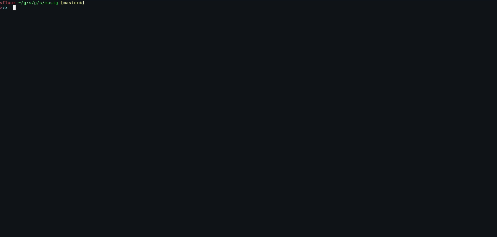

# musig :speaker:

[](https://godoc.org/github.com/sfluor/musig)
[](https://circleci.com/gh/sfluor/musig/tree/master)

A shazam-like tool that allows you to compute song's fingerprints and reverse lookup song names.

It's more or less an implementation of the shazam paper as described in [this awesome article](http://coding-geek.com/how-shazam-works/)

## Installation

You will need to have [go](https://golang.org/doc/install) on your computer (version > 1.11 to be able to use go modules).

The `load`, `read` and `spectrogram` commands are pure Go and need no extra dependency. The `listen` and `record` commands rely on [portaudio](http://www.portaudio.com/) to access the microphone and are built behind the `portaudio` build tag (enabled by default in the Makefile). On a machine without portaudio you can still build everything else with `make TAGS= build`, or `go build ./...` with `CGO_ENABLED=0`.

To build the binary (requires portaudio for the microphone commands, e.g. `brew install portaudio` on macOS, `apt install portaudio19-dev` on Debian / Ubuntu):

```bash
git clone git@github.com:sfluor/musig.git
cd musig
make
```

You will then be able to run the binary with:

`./bin/musig help`

## Usage



To do some testing you can download `wav` songs by doing `make download`.

Load them with `./bin/musig load "./assets/dataset/wav/*.wav"`

Loading is idempotent and content aware:

- loading the same file again does not add any fingerprint entry and the song name keeps its stable song ID,
- when a same-named file contains new content, its previous fingerprint set is atomically retired inside a single database transaction and replaced by the new one, so queries only ever match the latest successfully loaded version while the song identity (name to ID mapping) is preserved,
- a failed write rolls back entirely: no half-written fingerprint set and no song name pointing at an empty ID can ever be observed; reloading the file recovers a consistent state,
- all of the above holds after closing and reopening the database, and under concurrent loads (a song name is mapped to a single ID, distinct songs can never overwrite each other's fingerprints).

And try to find one of your song name with:

`./bin/musig read "$(ls ./assets/dataset/wav/*.wav | head -n 1)"`

You can also try to use it with your microphone using the `listen` command:

`./bin/musig listen`

If you want to record a sample and reuse it multiple times after you can also use the `record` command:

`./bin/musig record`

For more details on the usage see the help command:

```
A shazam like CLI tool

Usage:
  musig [command]

Available Commands:
  help        Help about any command
  listen      listen will record the microphone input and try to find a matching song from the database (Ctrl-C will stop the recording)
  load        Load loads all the audio files matching the provided glob into the database (TODO: only .wav are supported for now)
  read        Read reads the given audio file trying to find it's song name
  record      record will record the microphone input and save the signal to the given file
  spectrogram spectrogram generate a spectrogram image for the given audio file in png (TODO: only .wav are supported for now)

Flags:
      --database string   database file to use (default "/tmp/musig.bolt")
  -h, --help              help for musig

Use "musig [command] --help" for more information about a command.
```

## Testing

To run the tests you can use `make test` in the root directory.

## TODOs

- [ ] improve the documentation
- [ ] support for `mp3` files
